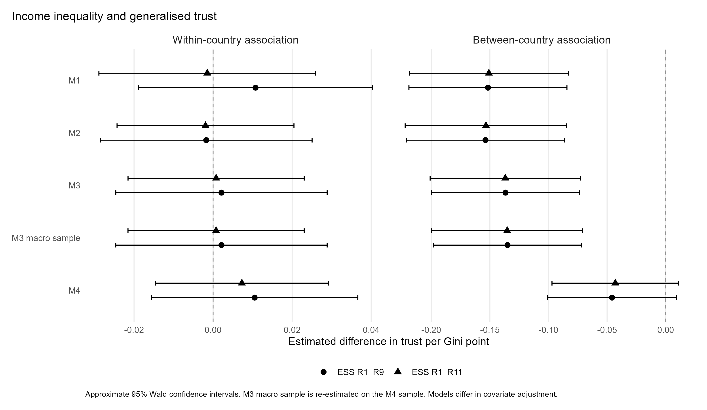
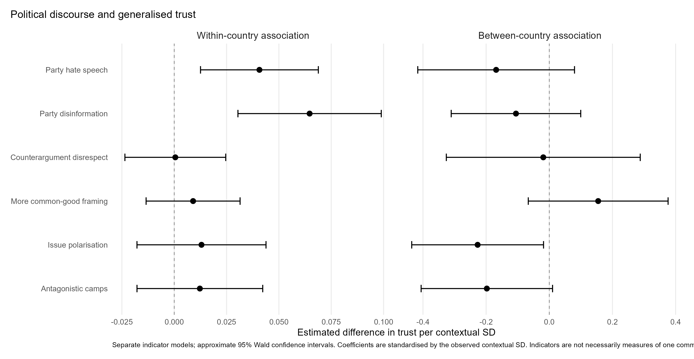
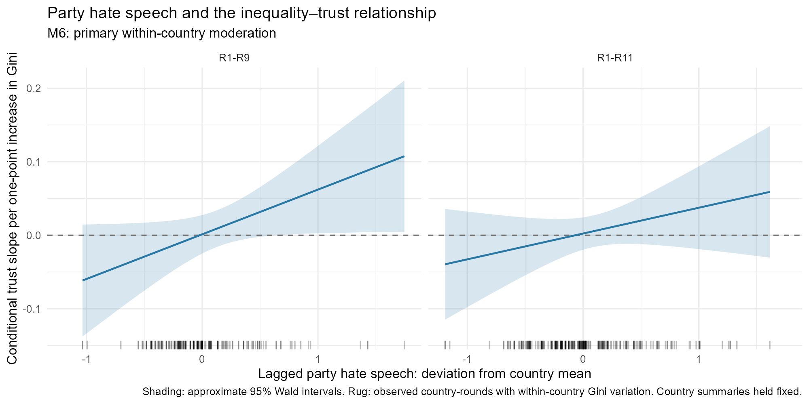
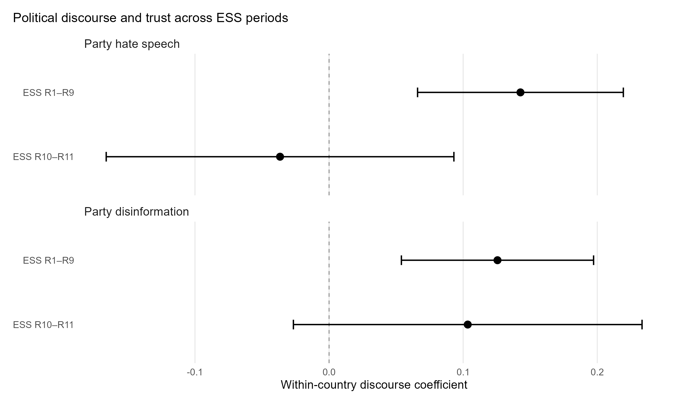

# Income Inequality, Political Discourse, and Generalised Trust in Europe
Scott Milligan
2026-10-14

*Working paper — Preliminary draft*

Keywords: income inequality; generalised trust; political discourse;
European Social Survey; social cohesion; multilevel models

# Abstract

The relationship between economic inequality and generalised trust has
attracted considerable scholarly attention, yet the extent to which
changes in inequality undermine trust remains contested. Moreover,
relatively little is known about how political discourse relates to this
association.

This paper examines income inequality, political discourse and
generalised trust using repeated cross-sectional data from eleven rounds
of the European Social Survey, combined with country-level inequality
estimates from the Standardized World Income Inequality Database and
political-context indicators from V-Dem. Random-effects within-between
models distinguish persistent differences between countries from changes
within countries over time.

The extended analytical sample comprises 498,461 respondents from 38
countries and 273 country-rounds. The results show a negative
between-country association between inequality and trust in simpler
specifications, which attenuates after macroeconomic adjustment.
Within-country inequality associations are small and statistically
uncertain. Political-discourse measures exhibit more varied
relationships: party hate speech and party social-media disinformation
are positively associated with trust in separate within-country
specifications, contrary to straightforward theoretical expectations.
Exploratory period-interaction models suggest a change in the party-hate
association in the later ESS rounds, but no comparable evidence for
disinformation.

These findings highlight the importance of distinguishing structural
differences, temporal changes and distinct dimensions of political
discourse when investigating the social consequences of inequality.

# Introduction

Generalised trust is widely regarded as an important foundation of
social cooperation. The expectation that other people can generally be
trusted may facilitate interaction beyond immediate social networks,
reduce uncertainty in everyday exchanges and support relationships
across social boundaries. Understanding why generalised trust varies
between societies and changes over time therefore remains a central
concern in comparative sociology.

Theoretical accounts of generalised trust emphasise both individual
dispositions and broader societal conditions. Uslaner
([2002](#ref-uslaner2002moral)), for example, conceptualises generalised
trust as a relatively enduring moral orientation extending beyond direct
interpersonal experience. From a comparative perspective, Delhey and
Newton ([2003](#ref-delhey2003trust)) demonstrate the importance of
perceived social conflict and public safety alongside individual
circumstances and social relationships. These approaches suggest that
trust is connected not only to individual characteristics but also to
the wider social environment in which people form expectations about
others.

Economic inequality is frequently identified as one factor that may
undermine this environment. Unequal societies may experience greater
social distance, more pronounced divisions between socioeconomic groups
and more conflict over the distribution of resources. Such conditions
could weaken expectations of reciprocity and common membership, reducing
individuals’ willingness to trust others. Rothstein and Uslaner
([2005](#ref-rothstein2005equality)) argue that economic equality and
equality of opportunity are important foundations of social trust,
linking the distribution of resources to institutional arrangements and
perceptions of fairness.

Yet the empirical relationship between inequality and trust is less
straightforward than these arguments might suggest. While
cross-sectional studies have frequently identified lower trust in more
unequal societies, longitudinal analyses have produced more mixed
results.

In an analysis of US states and counties, Fairbrother and Martin
([2013](#ref-fairbrother2013inequality)) find that the negative
association between inequality and trust is primarily cross-sectional,
with little evidence that increases in inequality within states are
associated with corresponding declines in trust. Re-examining the
relationship using an extended observation period and alternative
inequality data, Hastings ([2018](#ref-hastings2018trust)) reaches
somewhat different conclusions. His results provide little evidence of a
persistent negative between-state association but some evidence of a
negative longitudinal relationship, although the latter is sensitive to
the treatment of common temporal trends.

These studies demonstrate that conclusions concerning the
inequality–trust relationship depend partly on whether the analysis
compares different societies or examines changes within them.

This distinction has considerable substantive importance. Countries with
persistently high levels of inequality may differ from more equal
societies in their institutional histories, political arrangements,
economic development and cultural expectations. Cross-national
correlations may therefore reflect enduring characteristics of societies
rather than the consequences of inequality itself. If increasing
inequality undermines trust, one would also expect some evidence of
change within countries over time, although such relationships may
develop slowly or depend on additional conditions.

A further question concerns the political context in which socioeconomic
differences are experienced and understood.

Economic inequality does not necessarily translate directly into
perceptions of social conflict. Political actors may emphasise
particular inequalities, construct narratives about their causes and
identify groups considered responsible for economic or social problems.
Such communication may influence how individuals interpret differences
between social groups and understand their relationships with others.

The importance of perceived social conflict is already apparent in the
comparative trust literature. Delhey and Newton
([2003](#ref-delhey2003trust)) identify beliefs about severe social
conflict as important correlates of trust across the seven societies
they examine. Their findings suggest that trust cannot be explained
solely through material circumstances or the objective distribution of
resources. People’s interpretations of their social environment also
matter.

More recent research on political cleavages provides a further reason to
examine these interpretive processes. Damhuis and Westheuser
([2024](#ref-damhuis2024cleavage)) investigate how political divisions
are embedded in ordinary reasoning, showing how differences in political
orientation are connected to everyday understandings of social groups
and moral boundaries. Although their analysis does not directly test the
relationship between political discourse and generalised trust, it
illustrates how political divisions may become meaningful through
socially situated interpretations of group belonging and difference.

Taken together, these arguments suggest that the relationship between
inequality and trust may depend partly on the political environment.
However, they do not establish that hostile political communication
necessarily reduces trust, or that inequality and political discourse
exert mutually reinforcing effects. Both propositions require empirical
assessment.

This paper therefore examines three related questions:

1.  To what extent is income inequality associated with generalised
    trust across European countries and within countries over time?
2.  How are different dimensions of political discourse associated with
    generalised trust, independently of economic inequality?
3.  Do the associations between inequality, political discourse and
    generalised trust vary across political contexts or historical
    periods?

The analysis makes three contributions.

First, it distinguishes between-country differences from within-country
changes in inequality using repeated cross-sectional data covering
eleven rounds of the European Social Survey. This permits a more
explicit examination of the distinction emphasised by previous
longitudinal research.

Second, it incorporates national-level measures of political discourse,
distinguishing party hate speech and disinformation from other
characteristics of political division. Rather than assuming that all
dimensions of political discourse operate similarly, the analysis
investigates their separate empirical associations with trust.

Third, it examines whether selected contextual associations vary between
the earlier and later ESS rounds. This provides an exploratory
assessment of temporal heterogeneity during a period characterised by
considerable political and social change.

The paper is concerned with generalised trust rather than social
cohesion as a whole. Social cohesion provides the broader motivation,
but trust is the specific attitudinal outcome under investigation.
Political trust, civic participation, social relationships and
generalised trust may be related, but they are not interchangeable
dimensions of social cohesion.

The results qualify some common expectations. While cross-national
inequality differences correspond to trust differences in simpler
models, the within-country inequality relationship is weak.
Political-discourse associations are more heterogeneous, with some
positive estimates that run contrary to the expectation that divisive
communication is necessarily associated with lower trust.

These findings motivate a more differentiated understanding of the
relationships linking economic inequality, political discourse and
interpersonal expectations.

# Theoretical background

## Economic inequality and generalised trust

Several mechanisms could explain why economic inequality might be
associated with lower generalised trust.

One concerns social distance and segregation. Greater disparities in
economic resources may reduce contact between individuals occupying
different positions in the income distribution. Unequal access to
neighbourhoods, institutions and social networks can limit opportunities
for interaction across socioeconomic boundaries. Where individuals
primarily interact with others in similar circumstances, expectations
concerning the trustworthiness of unfamiliar groups may become weaker.

A second explanation concerns social conflict and resentment. Economic
inequality may generate perceptions of unfairness, exploitation or
unequal treatment. When material disparities are interpreted as evidence
that social arrangements favour particular groups, confidence in the
fairness and reciprocity of social relationships may diminish.

These arguments are consistent with theoretical approaches linking trust
to social equality and institutional fairness ([Rothstein and Uslaner
2005](#ref-rothstein2005equality)), as well as evidence concerning the
importance of perceived social conflict ([Delhey and Newton
2003](#ref-delhey2003trust)).

A third perspective emphasises status comparisons and insecurity.
Greater inequality may intensify perceived differences in social
standing or increase anxiety about one’s relative position. Such
experiences could affect expectations about the intentions and behaviour
of others.

However, the empirical support for these mechanisms is uneven. In his
analysis of inequality and trust across US states, Hastings
([2018](#ref-hastings2018trust)) finds limited support for status
anxiety as the principal mechanism, while reporting more suggestive
evidence concerning social fractionalisation and conflict.

These explanations also imply potentially different temporal processes.

Enduring socioeconomic segregation may produce relatively stable
differences in trust between societies, even when short-term inequality
changes have little measurable association with trust. Conversely, sharp
economic or political changes might influence trust more quickly,
particularly when they alter perceptions of fairness or relations
between social groups.

For this reason, between-country and within-country associations should
be distinguished analytically. The former describes whether countries
with persistently higher inequality exhibit lower trust. The latter
describes whether trust differs when inequality deviates from a
country’s own longer-term average.

The primary expectations are:

H1a: Within-country inequality. Increases in economic inequality within
countries are associated with decreases in generalised trust.

H1b: Between-country inequality. Countries with persistently higher
economic inequality exhibit lower levels of generalised trust.

The distinction between these expectations is central to the study.
Evidence supporting one does not necessarily support the other.

## Political discourse and the interpretation of social divisions

Economic disparities are not experienced independently of political and
cultural interpretation.

Political parties and other actors compete to define social problems,
identify their causes and mobilise support around particular
interpretations. Through these processes, economic and social
differences may become politically salient.

Divisive political communication may reinforce boundaries between groups
by presenting differences as fundamental conflicts of interest, identity
or belonging. In some circumstances, political rhetoric may portray
particular groups as threatening, undeserving or responsible for
collective difficulties.

Such narratives could undermine expectations of cooperation across
social boundaries. However, this possibility depends on how political
communication is received, interpreted and connected to everyday
expectations about other people.

Research on political cleavages illustrates the importance of such
interpretive processes. Damhuis and Westheuser
([2024](#ref-damhuis2024cleavage)) demonstrate that political divisions
can be anchored in ordinary reasoning and moral classifications, even
among individuals who do not possess fully developed ideological
frameworks.

This perspective suggests that political conflict can extend beyond
explicit political preferences into broader understandings of social
relationships.

Nevertheless, political discourse is not a single construct.

Party hate speech involves rhetoric directed against social groups,
whereas party disinformation concerns the dissemination of false or
misleading information through political communication. Disregard for
counterarguments concerns the quality of political deliberation, while
antagonistic political camps and issue polarisation describe broader
patterns of political and social division.

These phenomena may overlap, but their implications for generalised
trust need not be identical.

Hate speech might be associated with distrust if it encourages suspicion
or antagonism towards social groups. Disinformation might influence
trust by changing perceptions of social reality, but its content and
targets may vary considerably.

Political polarisation could reinforce group boundaries while
simultaneously generating solidarity within particular groups. Such
processes might affect political trust, outgroup attitudes and
generalised interpersonal trust differently.

Consequently, the direction and magnitude of associations between
political discourse and generalised trust remain empirical questions.

The analysis investigates the expectation that more divisive political
discourse is associated with lower generalised trust, while recognising
that the available national-level indicators do not identify the
political messages encountered by individual respondents.

## Does political discourse condition the inequality–trust relationship?

Political discourse may also shape the significance of economic
inequality for generalised trust.

One possibility is that economic disparities become more socially
consequential when political actors emphasise conflict between groups.
Under such conditions, inequality may be interpreted not simply as an
economic distribution but as evidence of antagonistic relationships,
unequal recognition or competing claims to social membership.

This argument is consistent with approaches linking inequality and trust
through perceived conflict and social divisions ([Delhey and Newton
2003](#ref-delhey2003trust); [Hastings 2018](#ref-hastings2018trust)).

It produces a moderation expectation:

H2: Political-discourse moderation. The within-country association
between economic inequality and generalised trust is more negative in
country-periods characterised by more divisive political discourse.

An alternative possibility is that political discourse and inequality
have separate associations with trust without necessarily interacting.

Political communication may reflect broader institutional, cultural or
political developments that influence trust independently of the income
distribution. Likewise, the implications of inequality may depend on
welfare institutions, redistribution, historical circumstances or
individual socioeconomic position rather than political rhetoric alone.

The present study examines both the proposed moderation relationship and
the independent associations of different political-discourse measures.

These analyses remain observational. They cannot establish that
individuals were exposed to particular political messages or that
political communication caused changes in their trust.

# Data and methods

## European Social Survey

The individual-level data come from Rounds 1–11 of the European Social
Survey (ESS), a repeated cross-sectional survey covering European
countries ([European Social Survey European Research Infrastructure (ESS
ERIC), n.d.](#ref-essericData)).

The primary outcome is generalised trust, measured using the ESS item
`ppltrst`. Respondents indicate whether most people can be trusted or
whether one cannot be too careful in dealing with people, using an
eleven-point scale from 0 to 10. Higher scores indicate greater
generalised trust.

The models adjust for respondents’ age, age squared, gender and years of
education. These variables account for selected differences in
respondent composition across survey samples.

The extended macro-complete analytical sample contains 498,461
respondents from 38 countries and 273 country-rounds. The earlier Rounds
1–9 sample contains 419,618 respondents from 37 countries and 226
country-rounds.

The samples exclude respondents with missing information on the relevant
outcome or covariates, and country-rounds lacking the contextual
variables required for the models.

The later ESS rounds include some video interviews alongside
predominantly in-person interviewing. The principal models retain
eligible respondents irrespective of these interview modes. Separate
sensitivity analyses restrict the sample to in-person interviews.

## Economic inequality

Income inequality is measured using the disposable-income Gini
coefficient from the Standardized World Income Inequality Database
(SWIID), version 9.92 ([Solt 2020](#ref-solt2020swiid)).

The measure concerns the distribution of equivalised household
disposable income after taxes and transfers.

SWIID provides broad country-year coverage and is designed to facilitate
cross-national comparisons. Its estimates are nevertheless model-based
and subject to measurement uncertainty.

The primary specification uses inequality measured approximately one
year before the respondent’s interview.

Because ESS fieldwork within a country-round can span more than one
calendar year, annual contextual values are aggregated using the
observed shares of interviews conducted in each year.

For example, a country-round containing 80% of interviews in 2016 and
20% in 2017 receives the following inequality exposure:

$$
Gini_{ct} = 0.8 Gini_{c,2015} + 0.2 Gini_{c,2016}
$$

This procedure preserves the country-round as the contextual unit while
accounting for actual fieldwork timing.

A separate sensitivity analysis propagates uncertainty across 100 SWIID
imputations for Rounds 1–9. The main extended political-discourse models
use the established country-round inequality point estimates.

## Political-discourse indicators

Political-discourse measures are obtained from the V-Dem Country-Year
dataset, version 16 ([Coppedge et al.
2026](#ref-coppedge2026vdem)).

The principal indicators include:

- Party hate speech (`v2smpolhate`): the extent to which major political
  parties use language intended to insult, offend or intimidate social
  groups.
- Party social-media disinformation (`v2smpardom`): the extent to which
  political parties disseminate false or misleading information to
  domestic audiences through social media.
- Counterargument disrespect (`v2dlcountr`): the extent to which
  political discourse lacks engagement with or respect for opposing
  arguments.
- Common-good justification (`v2dlcommon`): the extent to which
  political actors justify positions in terms of broader collective
  interests.
- Issue polarisation (`v2smpolsoc`): the extent to which society is
  polarised around major political issues.
- Antagonistic political camps (`v2cacamps`): the extent of political
  polarisation into opposing societal camps.

The indicators are oriented for comparative analysis so that higher
values generally indicate greater levels of the characteristic named in
the analysis. Specifically, party hate speech and disinformation are
reverse-coded so that higher scores represent more frequent hostile
rhetoric or disinformation.

V-Dem measures are national-level assessments rather than direct
measures of individual exposure to political messages. Several
indicators rely on expert assessments and latent-variable estimation,
introducing uncertainty that is not fully represented by the point
estimates ([Pemstein et al.
2026](#ref-pemstein2026measurement)).

As with inequality, annual contextual values are matched to ESS
country-rounds using the observed interview-year distribution. The
principal specifications use one-year-lagged indicators.

## Statistical strategy

The empirical strategy employs random-effects within-between (REWB)
multilevel linear models ([Bell and Jones
2015](#ref-bell2015fixedeffects)).

Each time-varying contextual variable is separated into a
between-country component and a within-country component.

For inequality:

$$
Gini_{ct} = \overline{Gini}_{c} + (Gini_{ct} - \overline{Gini}_{c})
$$

The country mean, $\overline{Gini}_{c}$, represents the average level of
inequality across observed survey periods.

The within-country component, $Gini_{ct} - \overline{Gini}_{c}$,
represents the deviation from this mean in a particular country-round.

Country means are constructed from unique country-round observations
rather than weighted by the number of respondents in each round.

This decomposition permits separate estimation of the association
between persistent contextual differences and generalised trust and the
association involving changes within countries over time.

The general model can be expressed as:

$$
Trust_{ict} = \beta_0 + \beta_W Gini^W_{ct} + \beta_B Gini^B_c + \boldsymbol{\gamma}'\mathbf{X}_{ict} + \boldsymbol{\lambda}'\mathbf{Z}_{ct} + \delta_t + u_c + v_{ct} + \varepsilon_{ict}
$$

Here, $\mathbf{X}_{ict}$ represents individual covariates and
$\mathbf{Z}_{ct}$ includes the within-country and between-country
components of macroeconomic controls.

The models include random intercepts for countries and country-rounds.
ESS-round fixed effects account for differences common to participating
countries in a particular round.

Macroeconomic controls comprise one-year-lagged GDP per capita at
purchasing power parity and unemployment, both decomposed into
within-country and between-country components.

The models are estimated by maximum likelihood using `lme4::lmer` in R,
with `REML = FALSE`.

The reported models are unweighted. Statistical uncertainty is
calculated under the assumptions of the fitted multilevel models,
including the specified random-effects structure.

The empirical sequence begins with inequality models, adds
political-discourse indicators and examines interactions between
within-country inequality and party hate speech.

Exploratory temporal models subsequently allow the within-country
party-hate and disinformation associations to differ between ESS Rounds
1–9 and Rounds 10–11.

These models retain ESS-round fixed effects and introduce an interaction
between the within-country discourse component and an indicator for the
later survey rounds.

The later-period indicator’s main effect is absorbed by the ESS-round
fixed effects.

A corresponding in-person analysis restricts the respondent sample
without recalculating the contextual exposures or country means.

# Results

## Economic inequality and generalised trust

The initial models indicate a negative between-country association
between income inequality and generalised trust.

In the Rounds 1–11 specification adjusting for ESS round and individual
characteristics, the between-country Gini coefficient is approximately
−0.137, with a 95% confidence interval of \[−0.201, −0.073\].

However, the association attenuates substantially when macroeconomic
controls are introduced. In the corresponding macro-adjusted model, the
coefficient is −0.043 \[−0.097, 0.011\], with a confidence interval that
includes zero.

The within-country results provide little evidence that changes in
income inequality are systematically associated with generalised trust.

In the Rounds 1–11 macro-adjusted model, the within-country Gini
coefficient is 0.007 \[−0.015, 0.029\].

Figure <a href="#fig-gini-coefficients" class="quarto-xref">Figure 1</a>
presents the within-country and between-country Gini coefficients across
the main model sequence for both the Rounds 1–9 and Rounds 1–11 samples.

Figure 1: Within-country and between-country Gini coefficients across
the main model specifications. Points indicate coefficient estimates and
horizontal intervals indicate approximate 95% Wald confidence intervals.
M3 macro sample is re-estimated on the macro-complete sample used for
M4.

The figure illustrates two features of the results. First, the
within-country coefficients remain close to zero across specifications,
with confidence intervals spanning zero. Second, the negative
between-country coefficients are substantially attenuated in M4, after
accounting for GDP per capita and unemployment.

The patterns are broadly consistent when the analysis is restricted to
Rounds 1–9. In addition, the analysis pooling estimates across 100 SWIID
imputations for the earlier rounds produces similar substantive
conclusions.

The findings therefore indicate that the relatively clear
inequality–trust association observed between countries in simpler
models does not translate into an equally clear within-country
relationship.

Persistent differences between societies appear more strongly associated
with trust than observed inequality changes, although the
between-country association itself is substantially attenuated after
macroeconomic adjustment.

This pattern is particularly relevant given the distinction between
cross-sectional and longitudinal inequality relationships emphasised by
Fairbrother and Martin ([2013](#ref-fairbrother2013inequality)) and
Hastings ([2018](#ref-hastings2018trust)).

## Political discourse and generalised trust

The political-discourse analyses produce more varied results.

In separate models, within-country party hate speech and party
disinformation are positively associated with generalised trust after
adjustment for inequality, macroeconomic conditions, survey round and
individual characteristics.

In the standardised within-between comparison, a one-standard-deviation
difference in the within-country party-hate component corresponds to an
estimated difference of approximately 0.041 points on the trust scale,
with a 95% confidence interval of \[0.013, 0.069\].

For party disinformation, the corresponding estimate is 0.065 \[0.030,
0.099\].

These positive associations run contrary to the simple expectation that
more hostile or misleading political communication necessarily
corresponds to lower generalised trust.

Figure
<a href="#fig-discourse-coefficients" class="quarto-xref">Figure 2</a>
compares the estimated associations for six political-discourse
indicators, distinguishing within-country deviations from
between-country differences.

Figure 2: Associations between political-discourse indicators and
generalised trust. Points indicate coefficients standardised by the
observed contextual standard deviation, with approximate 95% Wald
confidence intervals. Each indicator is estimated in a separate model.
The two panels distinguish within-country and between-country
associations.

Other within-country political-context indicators, including
counterargument disrespect, issue polarisation and antagonistic
political camps, do not exhibit comparably clear associations in their
separate specifications.

Between countries, issue polarisation exhibits a negative association
with trust. Its standardised between-country coefficient is
approximately −0.227 \[−0.436, −0.018\].

The distinction between within-country and between-country results is
therefore important. Political-discourse measures do not display a
uniform relationship with generalised trust, and their estimated
associations vary according to both the indicator and the level of
comparison.

Models including multiple political-discourse indicators suggest that
the party-hate association becomes weaker after adjustment for other
discourse measures, whereas the positive disinformation association is
comparatively more persistent.

These findings must be interpreted cautiously because the indicators may
capture overlapping aspects of political change.

Furthermore, a positive association between an unfavourable form of
political communication and generalised trust does not imply that such
communication has a beneficial causal effect.

Rather, the association may reflect omitted contextual factors,
differences in the political circumstances under which particular forms
of communication occurs, or the distinction between generalised
interpersonal trust and evaluations of political actors.

## Political-discourse moderation

The principal moderation hypothesis concerns whether within-country
party hate speech conditions the association between income inequality
and generalised trust.

The full Rounds 1–11 model estimates a positive interaction coefficient
of approximately 0.035, with a 95% confidence interval of \[−0.022,
0.092\].

This result does not provide clear evidence that higher levels of party
hate speech strengthen a negative within-country inequality–trust
association.

The positive point estimate is also contrary to the expected direction,
although its statistical uncertainty does not support a strong
substantive conclusion about the moderation relationship.

Figure
<a href="#fig-conditional-gini-slopes" class="quarto-xref">Figure 3</a>
displays the estimated conditional within-country inequality slopes
across the observed range of within-country party hate speech,
separately for the Rounds 1–9 and Rounds 1–11 model specifications.

Figure 3: Conditional within-country inequality coefficients across
deviations in lagged party hate speech from country means, estimated
from the M6 moderation models. Lines represent estimated conditional
Gini slopes, shaded areas show approximate 95% Wald confidence
intervals, and rugs indicate observed country-round values. The two
panels represent overlapping analytical samples rather than mutually
exclusive historical periods.

The estimated conditional inequality slopes become more positive as
party hate speech increases relative to its country mean. However, the
uncertainty intervals are substantial and generally include zero across
the observed moderator range.

The plot is consistent with the positive but statistically uncertain
moderation coefficient. It does not support the hypothesised pattern of
an increasingly negative inequality–trust association in more hostile
political environments.

Consequently, the analysis provides little support for the proposition
that divisive political rhetoric amplifies the association between
rising inequality and declining trust, at least as operationalised
through the selected national-level party-hate indicator.

The absence of a clear interaction should not be interpreted as evidence
that political discourse is irrelevant to the social consequences of
inequality. Rather, the hypothesised moderation relationship is not
convincingly supported by this specification.

## Temporal differences in political-discourse associations

Exploratory period-interaction models investigate whether the
associations between within-country political discourse and generalised
trust differ between ESS Rounds 1–9 and Rounds 10–11.

For party hate speech, the estimated earlier-period slope is 0.143,
compared with −0.037 in the later period.

The estimated difference is −0.179, with a likelihood-ratio interaction
test indicating evidence against the common-slope specification ($p$ =
0.023).

For party disinformation, the corresponding estimates are 0.126 and
0.103.

The estimated difference is considerably smaller (−0.022) and
statistically uncertain ($p$ = 0.765).

Figure <a href="#fig-period-discourse" class="quarto-xref">Figure 4</a>
displays the period-specific slopes and their confidence intervals. The
shared horizontal scale makes the estimated change in the party-hate
association particularly apparent.

Figure 4: Within-country associations between political discourse and
generalised trust in ESS Rounds 1–9 and Rounds 10–11. Points represent
period-specific model-estimated slopes and horizontal lines indicate
approximate 95% Wald confidence intervals. The figure uses all-mode
estimates. Indicators have different measurement scales, so coefficient
magnitudes should not be compared directly. Formal tests of differences
between period-specific slopes are reported separately in the text.

The corresponding numerical estimates are summarised in Table
<a href="#tbl-discourse-periods" class="quarto-xref">Table 1</a>.

Table 1: Period-specific political-discourse associations with
generalised trust. All-mode estimates. The difference refers to the
R10–R11 slope minus the R1–R9 slope. Interaction $p$ values are from
likelihood-ratio comparisons of the common-slope and period-interaction
models.

| Indicator            | R1–R9 slope | R10–R11 slope | Difference | Interaction $p$ |
|:---------------------|------------:|--------------:|-----------:|----------------:|
| Party hate speech    |       0.143 |        −0.037 |     −0.179 |           0.023 |
| Party disinformation |       0.126 |         0.103 |     −0.022 |           0.765 |

The in-person sensitivity analyses produce very similar results. This
suggests that the observed patterns are not driven primarily by the
relatively small number of later-round respondents interviewed through
other modes.

Several qualifications are nevertheless necessary.

First, the later period contains only 47 country-rounds from 29
countries, limiting the contextual information available to estimate
period-specific associations.

Second, the temporal contrast coincides with important historical
developments and changes in survey implementation. It cannot be
interpreted as an identified causal effect of the COVID-19 pandemic or
any other particular event.

Third, evidence of a period interaction for one indicator but not
another does not establish that the two interaction coefficients differ
significantly from one another.

Finally, the temporal interaction tests are exploratory and form part of
a wider set of model comparisons. Their nominal significance levels
should therefore be interpreted cautiously.

The results suggest possible temporal heterogeneity in the party-hate
association, but provide little evidence of an analogous change in the
disinformation association.

# Discussion

Three findings emerge from the analysis.

First, the relationship between income inequality and generalised trust
depends strongly on the distinction between persistent differences among
countries and changes within countries.

More unequal societies exhibit lower trust in simpler specifications,
but this relationship becomes less pronounced after adjusting for
macroeconomic characteristics. The within-country inequality association
remains comparatively weak throughout the analysis.

This finding reinforces a central methodological lesson from the
longitudinal inequality–trust literature: cross-national inequality
differences should not be assumed to represent the consequences of
changing inequality within societies ([Fairbrother and Martin
2013](#ref-fairbrother2013inequality); [Hastings
2018](#ref-hastings2018trust)).

The apparent importance of persistent cross-national differences also
raises questions about the broader institutional and historical
characteristics associated with both inequality and trust.

For example, the relationship between equality, trust and institutional
quality emphasised by Rothstein and Uslaner
([2005](#ref-rothstein2005equality)) suggests that the distribution of
income may form part of a broader set of enduring societal arrangements.
The present results do not identify those arrangements directly, but
they indicate why an exclusive focus on changes in income inequality may
be insufficient.

Second, political discourse does not exhibit a uniform negative
association with generalised trust.

Some measures of divisive political communication have positive
within-country coefficients, while other measures display weak or
statistically uncertain associations.

This suggests that different dimensions of political communication
should be examined separately rather than automatically combined into a
general index of divisiveness.

The positive associations involving party hate speech and disinformation
are especially important because they conflict with the initial
theoretical expectations.

These findings should not be interpreted as evidence that hostile
rhetoric or disinformation increases trust. The observed associations
may reflect broader political developments, unmeasured contextual
characteristics, changing forms of political mobilisation or limitations
of the national-level indicators.

They may also reflect an important distinction between generalised
interpersonal trust and attitudes directed towards political actors or
institutions.

A deterioration in political communication need not be accompanied by an
equivalent change in expectations concerning the trustworthiness of
other people.

This possibility is compatible with the broader insight that generalised
trust may involve relatively durable expectations extending beyond
direct political experience ([Uslaner 2002](#ref-uslaner2002moral)).

At the same time, research on the everyday interpretation of political
cleavages suggests that political divisions can become embedded in
broader understandings of social difference ([Damhuis and Westheuser
2024](#ref-damhuis2024cleavage)). Identifying when this occurs, and
whether it influences generalised trust, requires more direct evidence
about individuals’ interpretations and experiences.

Third, the temporal analyses suggest that associations between
political-discourse measures and trust may not be constant across
historical periods.

The party-hate association appears weaker in the later ESS rounds,
whereas there is less evidence of a comparable change for party
disinformation.

These findings are exploratory. The later rounds contain relatively few
country-rounds, and the observed differences may reflect changes in
historical context, country composition or other unmeasured conditions.

Nevertheless, the results suggest that contextual political indicators
should not automatically be assumed to have stable associations with
generalised trust across all periods.

The broader theoretical implication is that economic inequality,
political discourse and generalised trust may be connected through more
complex processes than a straightforward cumulative model of social
deterioration would suggest.

Material disparities, political mobilisation and interpersonal
expectations need not change in parallel.

A more differentiated account may require closer examination of how
economic and political changes are experienced and interpreted by
individuals, rather than assuming that national-level contextual changes
translate directly into changing generalised trust.

# Limitations and future research

Several limitations qualify the findings.

First, the analysis is observational. The within-between decomposition
distinguishes persistent differences from temporal deviations but does
not eliminate time-varying confounding, reverse causality or common
determinants of political discourse and trust.

Second, the effective contextual sample is considerably smaller than the
individual respondent sample. Inference concerning national political
conditions depends on variation across countries and survey periods
rather than the total number of respondents alone.

The current multilevel models use random intercepts and model-based
standard errors. More conservative approaches to uncertainty estimation,
particularly those accounting for the limited number of higher-level
units, should be examined before drawing stronger conclusions.

Third, the main models do not apply ESS survey weights. Alternative
weighting strategies may change the relative influence of countries,
periods and respondent groups. These decisions require explicit
methodological justification.

Fourth, the contextual indicators contain measurement uncertainty.

Although the SWIID imputation exercise provides reassuring results for
the earlier rounds, the main extended political-discourse models do not
propagate uncertainty in the V-Dem estimates.

The meaning and comparability of social-media disinformation across the
entire historical period also deserve consideration, given changes in
the role of social-media platforms in political communication.

Fifth, the later ESS rounds differ from earlier rounds in historical
context and aspects of survey implementation. The in-person restriction
addresses one part of this issue but cannot establish complete
equivalence.

Sixth, national political-discourse indicators describe the political
environment rather than respondents’ exposure to particular political
messages. They do not capture how individuals interpret rhetoric, which
actors they encounter or whether political communication alters their
interpersonal expectations.

Finally, the analysis examines average contextual associations. It does
not establish whether divisive political communication has different
implications for individuals occupying different social positions.

Economic insecurity, educational attainment and other dimensions of
social advantage or disadvantage may condition how political messages
are interpreted.

Such heterogeneity represents a promising direction for subsequent
research, potentially using approaches designed to identify variation
across intersectionally defined social groups.

# Conclusion

This paper examines whether economic inequality and political discourse
are associated with generalised trust across European societies and over
time.

The results qualify the expectation that rising inequality necessarily
undermines trust.

Between-country inequality differences are more clearly associated with
trust than changes within countries, and the former association
attenuates after macroeconomic adjustment.

Political discourse exhibits a more heterogeneous pattern. Some
indicators of divisive political communication have positive
within-country associations with trust, while evidence for moderation of
the inequality–trust relationship is limited.

Exploratory temporal analyses suggest a possible change in the
association involving party hate speech, but provide little evidence of
a comparable change in the disinformation association.

These findings do not imply that economic inequality or divisive
political communication is socially inconsequential.

Rather, they suggest that the relationships linking material
inequalities, political divisions and interpersonal trust cannot be
inferred from cross-national correlations or straightforward theoretical
expectations alone.

Understanding these relationships requires attention to distinct
temporal processes, different dimensions of political discourse and the
ways in which social divisions are experienced and interpreted by
individuals.

# References

Bell, Andrew, and Kelvyn Jones. 2015. ‘Explaining Fixed Effects: Random
Effects Modeling of Time-Series Cross-Sectional and Panel Data’.
*Political Science Research and Methods* 3 (1): 133–53.
<https://doi.org/10.1017/psrm.2014.7>.

Coppedge, Michael, John Gerring, Carl Henrik
Knutsen, et al. 2026. *V-Dem Country-Year
Dataset v16*. Varieties of Democracy (V-Dem) Project.
<https://doi.org/10.23696/vdemds26>.

Damhuis, Koen, and Linus Westheuser. 2024. ‘Cleavage Politics in
Ordinary Reasoning: How Common Sense Divides’. *European Societies* 26
(4): 1195–231. <https://doi.org/10.1080/14616696.2023.2300641>.

Delhey, Jan, and Kenneth Newton. 2003. ‘Who Trusts? The Origins of
Social Trust in Seven Societies’. *European Societies* 5 (2): 93–137.
<https://doi.org/10.1080/1461669032000072256>.

European Social Survey European Research Infrastructure (ESS ERIC). n.d.
*European Social Survey (ESS): Data and Documentation*.
<https://www.europeansocialsurvey.org/data/>.

Fairbrother, Malcolm, and Isaac William Martin. 2013. ‘Does Inequality
Erode Social Trust? Results from Multilevel Models of US States and
Counties’. *Social Science Research* 42 (2): 347–60.
<https://doi.org/10.1016/j.ssresearch.2012.09.008>.

Hastings, Orestes P. 2018. ‘Less Equal, Less Trusting? Longitudinal and
Cross-Sectional Effects of Income Inequality on Trust in U.S. States,
1973–2012’. *Social Science Research* 74: 77–95.
<https://doi.org/10.1016/j.ssresearch.2018.04.005>.

Pemstein, Daniel, Kyle L. Marquardt, Eitan Tzelgov,
et al. 2026. *The V-Dem Measurement Model: Latent Variable
Analysis for Cross-National and Cross-Temporal Expert-Coded Data*. V-Dem
Working Paper No. 21. Varieties of Democracy Institute, University of
Gothenburg. <https://v-dem.net/wp.html>.

Rothstein, Bo, and Eric M. Uslaner. 2005. ‘All for All: Equality,
Corruption, and Social Trust’. *World Politics* 58 (1): 41–72.
<https://doi.org/10.1353/wp.2006.0022>.

Solt, Frederick. 2020. ‘Measuring Income Inequality Across Countries and
over Time: The Standardized World Income Inequality Database’. *Social
Science Quarterly* 101 (3): 1183–99.
<https://doi.org/10.1111/ssqu.12795>.

Uslaner, Eric M. 2002. *The Moral Foundations of Trust*. Cambridge
University Press. <https://doi.org/10.1017/CBO9780511614934>.

